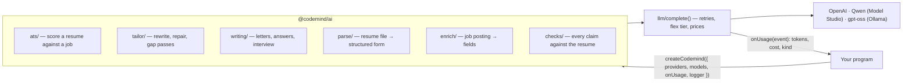

# @codemind/ai

The AI code behind [CodeMind Jobs](https://jobs.codemind.site), a job search site that scores
resumes against job postings, tailors them, and drafts cover letters and application answers. This
repository is that code on its own: model calls, ATS scoring, resume tailoring, letters, interview
prep, resume parsing and rendering, and job posting enrichment.

It never touches a database, the environment, users or billing. The program around it hands in
what it needs once, and every answer a model gives is checked in code before anything uses it.



## What is in it

| Folder | What it does |
| --- | --- |
| `llm/` | `complete()`, the one door to the model: providers chosen by model name, retries, OpenAI's flex tier, the Batch API, prices, metering |
| `ats/` | a posting's requirements read once, then a resume judged against each one. The model gives a verdict per requirement with a quote; the score is worked out in code |
| `tailor/` | the rewrite for one job in three modes (score first, balanced, looks real), a repair round, gap passes for what is still missing, and the whole pipeline (`runTailoring`) |
| `writing/` | cover letters (with each market's letter conventions), application answers, referral requests, interview prep and feedback on a practice answer |
| `parse/` | an uploaded resume read into a structured form |
| `enrich/` | a job posting read into fields (category, work type, location, salary, skills…), validated against the posting's own text, retried with the failed checks |
| `checks/` | figures, tenures and certifications a model wrote, checked against what the resume actually says |
| `text/` | keywords, a skills dictionary, countries and a city gazetteer, seniority, salaries, prompt fences, voice rules |
| `resume/` | the structured resume form, text extraction from PDF and DOCX, `.docx` and PDF rendering in three ATS-safe templates |
| `testing/` | a scripted fake model, and snapshots of every prompt the features send |

## Quick start

Node 22 or later.

```bash
npm install
npm test                                        # 300+ tests, no API key needed
node examples/offline.js                        # scoring against a scripted model, no key
OPENAI_API_KEY=sk-... node examples/score.js    # one real scoring call (a fraction of a cent)
```

```js
import { createCodemind } from '@codemind/ai';

const ai = createCodemind({
  providers: { openai: { apiKey: process.env.OPENAI_API_KEY } },
  models: () => ({
    defaultModel: 'gpt-4o-mini',
    ats: { model: 'gpt-4.1-mini', fallbackModel: 'gpt-5-mini', effort: 'minimal', fallbackEffort: 'minimal' },
    enrich: { model: 'gpt-5-nano', effort: 'low', fallbackModel: 'gpt-5-mini', fallbackEffort: 'low' },
    parse: { model: 'gpt-5-mini', effort: 'minimal', fallbackModel: 'gpt-5-mini', fallbackEffort: 'low' },
  }),
  onUsage: (event) => console.log(event.kind, event.model, `$${event.costUsd.toFixed(5)}`),
});

const score = await ai.quickScoreResume(resumeForm, job);
console.log(score.score, score.requirements);
```

- **Setup:** one setup per process. `models` is read on every call, so a change applies at once.
  Until `createCodemind()` runs, a model call throws instead of going out unmetered.
- **Errors:** errors are `AiError`s with a `status`, a stable `code` (`ai_no_credits`,
  `upstream_failed`, …) and a message safe to show a user.
- **Types:** the public functions carry JSDoc types, and `src/types.js` holds the shapes
  (`ResumeForm`, `Job`, `Scoring`, `UsageEvent`, …). An editor shows them without a build step.
- **Imports:** the root export is everything that may call a model. `@codemind/ai/text/*` and
  `@codemind/ai/resume/*` are pure and can be imported by path.

## How it is tested

### Request cancellation and tailoring review

Completion-based feature calls accept `meta.signal` (an `AbortSignal`) and `meta.deadlineAt` (an absolute Unix
timestamp in milliseconds). The deadline is shared across retries, fallbacks and model calls;
cancelled or expired requests throw `AiError` codes `ai_cancelled` or `ai_timeout` without trying
another model. Normal provider timeouts and retry settings remain in effect when these are absent.
Deadlines must be within the next 2,147,483,647 milliseconds (the timer limit).
These controls bound completion requests and retry waits; Batch API submission/polling is
separate. Injected usage callbacks should complete promptly. An injected client that ignores
the signal may continue its own work after this package stops waiting for it.

`runTailoring()` also accepts a positive integer `timeoutMs`, which sets a workflow-wide deadline:

```js
const controller = new AbortController();
const result = await ai.runTailoring({
  form: resumeForm,
  originalText: resumeText,
  job,
  model: 'gpt-4o-mini',
  timeoutMs: 120_000,
  meta: { signal: controller.signal },
  requireConfirmedKeywords: true,
  confirmedKeywords: ['Kubernetes'], // Only after the candidate confirms it.
});
// controller.abort() can be called by a cancel action while this operation is running.
console.log(result.completion.status, result.completion.warnings);
console.log(result.review.required, result.review.unconfirmedKeywords, result.review.estimates);
```

Confirmation-only mode is opt-in and applies to the full `runTailoring()` workflow. It leaves
known missing job terms unfilled unless confirmed, and conservatively restores source sections
if a model or repair introduces a blocked term. This may discard valid edits in that section.
It is not a general semantic truth checker and does not apply automatically to direct calls to
`tailorResumeForm()` or `fillTailoringGaps()`. Estimated figures still require review.

Every pipeline result includes `completion` and `review`. A `partial` status means an optional
stage failed or a confirmation guard restored a section; the last accepted result is retained.
`complete` does not mean the target score was reached—check `targetReached`. A host should show
warnings, let users inspect assumptions and estimates, and require their review before export.
These are integration hooks; the frontend and its export controls are outside this repository.

Provider errors in logs and failure usage events now use stable diagnostic categories rather
than raw provider messages. Rejected responses retain provider-reported tokens and costs.
An aborted request without a returned usage payload still cannot report the provider's actual
billable usage; zero tokens in that case does not establish that the provider charged nothing.

### Synthetic evidence evaluation

```bash
node src/testing/evaluateEvidence.js
```

This diagnostic uses four labeled cases and no API calls. It reports the current checks'
results, including the known limitation that an authentic but irrelevant quote can earn credit.
It exits successfully after reporting results, not as a passing semantic-quality gate. No live
model accuracy or performance improvement is inferred from this small dataset.

### Unit tests and prompt snapshots

`src/testing/prompts.test.js` runs every feature through the real `complete()` against a scripted
model. It pins each request in `src/testing/snapshots/*.txt`: the messages, model, settings,
response schema and how the call is metered. A refactor that changes any prompt shows up as a
snapshot diff. After a deliberate prompt change, run `UPDATE_SNAPSHOTS=1 npm test` and review the
diff.

## Status

This code runs in production at CodeMind Jobs, where it was extracted from a larger private app.
Comments still refer to that app now and then. It is shared to read and learn from.

There is no license, so all rights are reserved: you may read the code and fork it on GitHub, but
not reuse it elsewhere. Parts are derived from open-source projects under their own licenses; see
[THIRD_PARTY_NOTICES.md](THIRD_PARTY_NOTICES.md).
